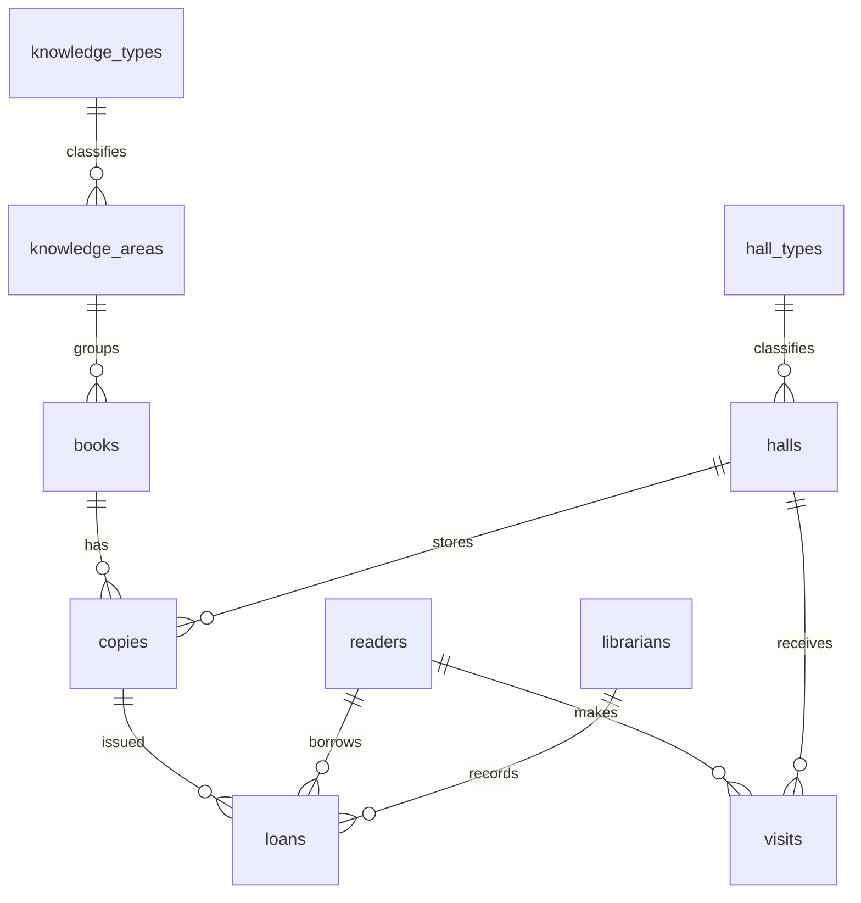

# Библиотека — Python и SQLite

Курсовая работа «Разработка базы данных для предметной области “Библиотека”», вариант 7.
Настольное приложение для учёта фонда, читателей, выдач и посещений.

**Технологии:** Python 3.10+, SQLite, SQL, Tkinter, unittest. Сторонние Python-пакеты не требуются.

## Задача и результат

Учёт изданий отделён от учёта физических экземпляров: у одной книги может быть несколько
экземпляров в разных залах. Приложение хранит историю выдач, оформляет возвраты,
помогает искать записи и выгружает таблицы и отчёты в CSV.

Правила предметной области проверяются в базе данных: нельзя выдать уже занятый
экземпляр, превысить пять активных выдач на читателя или выдать ему вторую копию
того же издания. Связанные записи защищены внешними ключами.
Это учебная работа; внедрение в действующую библиотеку не заявляется.

## Запуск

```bash
git clone https://github.com/Molotovsng/library-coursework.git
cd library-coursework
python main.py
```

При первом запуске создаётся `data/library.db` с демонстрационными данными.
На Windows также можно запустить `start.bat`. Нужна сборка Python с Tcl/Tk.
В некоторых дистрибутивах Linux Tkinter устанавливается отдельно.

```bash
# Отдельная пустая база; существующий файл не перезаписывается
python init_db.py --path data/empty.db --empty
python main.py --db data/empty.db

# Проверки на временных базах
python -m unittest discover -s tests -v
```

## Навигация для работодателя

| Навык | Где посмотреть |
| --- | --- |
| Реляционная модель | [schema.sql](schema.sql): 10 таблиц, связи, индексы, ограничения и триггеры |
| Работа с данными | [db.py](db.py): параметризованные запросы, транзакции, проверка полей и дат |
| SQL-аналитика | [queries](queries): CTE, соединения, группировки, подзапросы |
| Прикладной интерфейс | [main.py](main.py): формы, поиск, возвраты, экспорт CSV |
| Проверка бизнес-правил | [tests/test_library.py](tests/test_library.py): ограничения и отчёты |

## Отчёты

1. Выдачи по каждому месяцу выбранного года, включая месяцы без выдач.
2. Самые старые книги в каждом зале, включая равные годы издания.
3. Залы, фонд которых соответствует выбранным типам знаний.
4. Пять самых востребованных книг за предыдущий календарный месяц.

## Модель данных



## Особенности и границы

Даты хранятся в формате ДД/ММ/ГГГГ по условиям задания; для сравнения SQL-запросы
преобразуют их в ISO-порядок. Приложение рассчитано на локальную работу:
пользовательская авторизация, сетевой сервер и резервное копирование не реализованы.
Демонстрационные записи генерируются из `init_db.py`; готовая база и личные документы
в репозиторий не включены.
